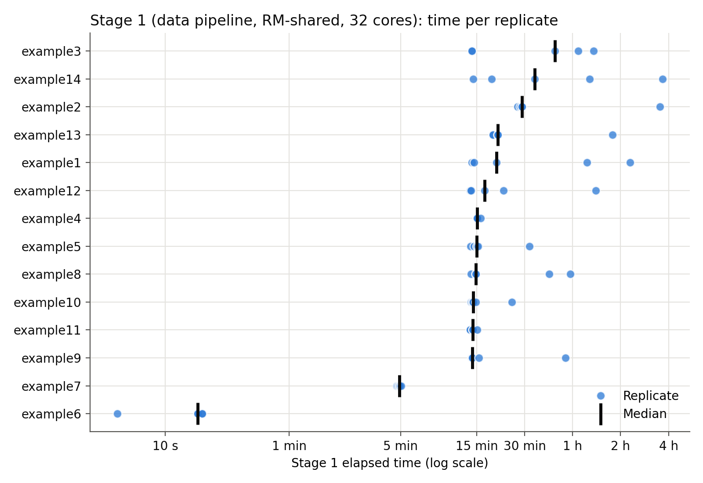
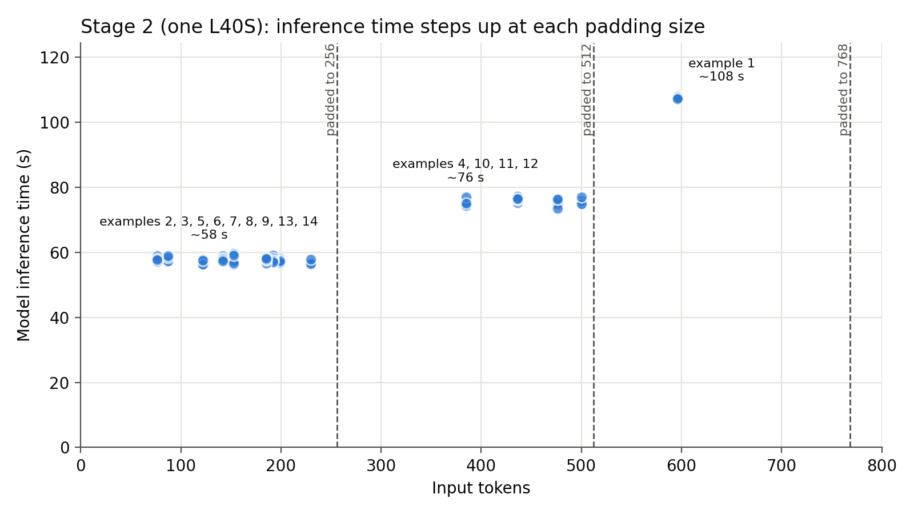
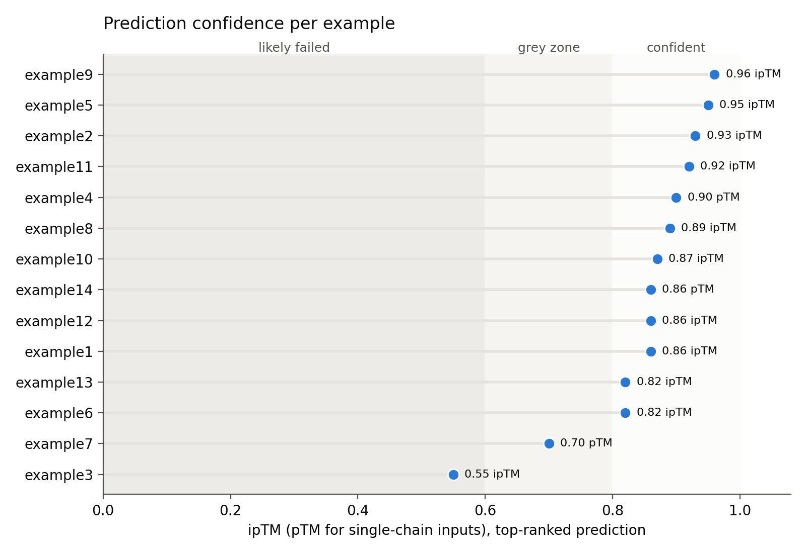

# Vanilla examples: results

Results from running all 14 vanilla examples on Bridges-2 with AlphaFold 3
v3.0.4 (`singularity-alphafold3-v3.0.4.sif`), 5 replicates each. Each example
ran as two Slurm job arrays, using the `stage1.sh` and `stage2.sh` scripts in
its directory:

| Stage | Partition | Resources | Ran |
| --- | --- | --- | --- |
| 1: data pipeline | `RM-shared` | 32 cores (about 64 GB of memory) | 2026-10-06 |
| 2: inference | `GPU-shared` | 1 NVIDIA L40S (48 GB), `--gpus=l40s-48:1` | 2026-10-09 |

All 70 replicates of both stages finished and wrote a predicted structure.

The job logs (`af3-data-<jobid>_<replicate>.out`,
`af3-inference-<jobid>_<replicate>.out`) and the `output/` directories are
kept in each example directory but are ignored by Git, so this file records
the results.

## Run all examples

`submit.sh` submits stage 1 and stage 2 for every example, each as a job array
of 5 replicates, with stage 2 on one L40S by default:

```bash
./submit.sh -A <allocation-id>            # all examples, replicates 1-5
./submit.sh -A <allocation-id> -n         # dry run: print the sbatch commands
./submit.sh -A <allocation-id> -r 1 -g h100-80 example1 example2
```

Replicates that already have a predicted structure, and examples with jobs
still queued or running, are skipped, so rerunning the same command retries
only failed replicates. See the comments in `submit.sh` for all options.

## Results

What the results show:

- **The predictions are reproducible.** Every replicate of an example gives
  the same structure scores, within 0.01, and they match the
  [earlier single run](#earlier-single-run). Rerunning an example on the same
  input and seed gives the same answer.
- **The predictions are mostly confident.** 13 of the 14 examples score 0.7
  or higher (ipTM for complexes, pTM for single chains), and none has
  clashes. The exception is example 3 (calmodulin with 4 Ca²⁺) at about
  0.56, likely because its two domains move relative to each other. See
  [How to read the scores](#how-to-read-the-scores).
- **Stage 2 (GPU) is fast and predictable.** It takes 1.5 to 2.5 minutes per
  example on one L40S, and the time depends only on the input size.
- **Stage 1 (CPU) takes most of the time and is unpredictable.** A typical
  replicate takes about 15 to 20 minutes, but the same input sometimes takes
  over 3 hours. Stage 1 used 35 hours in total across all replicates,
  compared with 2 hours for stage 2. Planning and allocation requests should
  therefore budget for the slow stage 1 runs, not the typical ones.

### Plots

`plot_results.py` draws these from the job logs and outputs into `plots/`:

```bash
./plot_results.py
```



Each dot is one replicate and the bar is the median, on a log scale. Most
replicates cluster around 15 minutes, while a few take hours.



Model inference time against input size. The time is flat within each padding
size and steps up between them.



ipTM (pTM for single chains) of the top-ranked prediction, against the
upstream confidence bands.

### Running times

Elapsed times come from the `Elapsed time:` line of each replicate's log. The
median and range are over the 5 replicates. Inference is the `Running model
inference with seed 1 took` time in the stage 2 log, which leaves out model
loading and featurisation. Tokens is the input size AlphaFold 3 reports.

| Example | What it predicts | Tokens | Stage 1 job | Stage 1 median | Stage 1 range | Stage 2 job | Stage 2 median | Stage 2 range | Inference (s), mean ± sd |
| --- | --- | ---: | --- | ---: | ---: | --- | ---: | ---: | ---: |
| [`example1`](example1/) | Protein homodimer (PDB 2PV7) | 596 | 47471930 | 00:20:00 | 00:14:02–02:17:51 | 48983161 | 00:02:34 | 00:02:29–00:02:35 | 107.8 ± 0.4 |
| [`example2`](example2/) | Protein heterodimer (barnase–barstar) | 199 | 47471932 | 00:28:51 | 00:27:07–03:31:22 | 48983162 | 00:01:31 | 00:01:26–00:01:34 | 57.4 ± 0.6 |
| [`example3`](example3/) | Protein with ions (calmodulin + 4 Ca²⁺) | 153 | 47471934 | 00:46:29 | 00:14:00–01:21:15 | 48983163 | 00:01:27 | 00:01:26–00:01:34 | 57.8 ± 1.5 |
| [`example4`](example4/) | Phosphorylated protein (ERK2 pThr185/pTyr187) | 385 | 47471936 | 00:15:04 | 00:15:04–00:15:56 | 48983164 | 00:01:54 | 00:01:50–00:01:57 | 75.4 ± 1.0 |
| [`example5`](example5/) | Covalent ligand (KRAS G12C + sotorasib) | 230 | 47471938 | 00:15:02 | 00:13:46–00:32:13 | 48983165 | 00:01:29 | 00:01:27–00:01:32 | 57.0 ± 0.5 |
| [`example6`](example6/) | Methylated double-stranded DNA | 192 | 47471940 | 00:00:16 | 00:00:05–00:00:17 | 48983166 | 00:01:33 | 00:01:27–00:01:34 | 57.9 ± 0.8 |
| [`example7`](example7/) | Modified RNA (tRNA-like fragment) | 87 | 47471942 | 00:04:55 | 00:04:43–00:05:03 | 48983167 | 00:01:27 | 00:01:26–00:01:30 | 58.0 ± 0.7 |
| [`example8`](example8/) | Glycoprotein (RNase B + N-glycan) | 185 | 47471944 | 00:14:48 | 00:13:52–00:57:53 | 48983168 | 00:01:27 | 00:01:25–00:01:29 | 57.7 ± 0.7 |
| [`example9`](example9/) | Protein + ligand from SMILES (streptavidin–biotin) | 142 | 47471946 | 00:14:08 | 00:13:53–00:54:07 | 48983169 | 00:01:27 | 00:01:25–00:01:31 | 58.1 ± 0.6 |
| [`example10`](example10/) | Protein–DNA complex (TetR dimer + tetO) | 476 | 47471948 | 00:14:16 | 00:13:47–00:24:59 | 48983170 | 00:01:54 | 00:01:50–00:01:56 | 75.1 ± 1.3 |
| [`example11`](example11/) | Protein homodimer + ligands (TetR + tetracycline) | 500 | 47471950 | 00:14:12 | 00:13:37–00:15:04 | 48983171 | 00:01:53 | 00:01:50–00:01:54 | 75.7 ± 0.9 |
| [`example12`](example12/) | Protein homodimer (TetR) | 436 | 47471952 | 00:16:48 | 00:13:39–01:23:47 | 48983172 | 00:01:54 | 00:01:52–00:01:57 | 76.3 ± 0.7 |
| [`example13`](example13/) | Protein–RNA complex (U1A + RNA hairpin) | 122 | 47471954 | 00:20:20 | 00:19:00–01:46:56 | 48983173 | 00:01:27 | 00:01:25–00:01:33 | 57.1 ± 0.7 |
| [`example14`](example14/) | Protein monomer (ubiquitin) | 76 | 47471956 | 00:34:46 | 00:14:18–03:40:03 | 48983174 | 00:01:29 | 00:01:27–00:01:29 | 58.0 ± 0.7 |
| **Total, all replicates** | | | | **35:07:04** | | | **01:57:01** | | |

Stage 2 is very consistent: every replicate of an example is within a few
seconds of the others. Inference takes about 57 s up to 256 tokens, about
75 s for 385 to 500 tokens, and 108 s for 596 tokens. That fits AlphaFold 3
padding inputs to fixed sizes (256, 512, 768, … tokens), so examples that pad
to the same size take the same time.

Stage 1 (the CPU-only MSA and template search) takes most of the time and
varies a lot between replicates of the same input. Most examples have a
median of 14 to 20 minutes, but some replicates took several times longer: up
to 3 h 40 min for example 14, against a median of 35 min. The input is the
same in every replicate, so the slow runs most likely come from load on the
shared nodes and on the database filesystem, not from the search itself. Use
the median as the expected stage 1 time and the range to budget for the worst
case. Example 6 has only DNA chains, which AlphaFold 3 doesn't search for
MSAs, so it finishes in seconds.

### Prediction confidence

Scores of the top-ranked prediction in each replicate, from
`output/replicate-<n>/<name>/<name>_summary_confidences.json`. Each replicate
made 5 samples from one seed. A single value means all 5 replicates gave the
same score; otherwise the column shows the range.

| Example | Output name | Replicates | Ranking score | pTM | ipTM | Fraction disordered | Has clash |
| --- | --- | ---: | ---: | ---: | ---: | ---: | ---: |
| [`example1`](example1/) | `2PV7` | 5/5 | 0.91 | 0.86 | 0.86 | 0.10 | no |
| [`example2`](example2/) | `barnase_barstar_complex` | 5/5 | 0.93 | 0.94 | 0.93 | 0.00 | no |
| [`example3`](example3/) | `calmodulin_4calcium` | 5/5 | 0.56–0.57 | 0.57 | 0.55–0.56 | 0.01 | no |
| [`example4`](example4/) | `ERK2_dual_phosphorylated` | 5/5 | 0.92 | 0.90 | – | 0.04 | no |
| [`example5`](example5/) | `KRAS_G12C_sotorasib_covalent` | 5/5 | 0.98 | 0.85 | 0.95 | 0.09 | no |
| [`example6`](example6/) | `methylated_CpG_dsDNA` | 5/5 | 0.82 | 0.82 | 0.82 | 0.00 | no |
| [`example7`](example7/) | `modified_RNA_hairpin` | 5/5 | 0.69–0.70 | 0.69–0.70 | – | 0.00 | no |
| [`example8`](example8/) | `RNaseB_glycosylated` | 5/5 | 0.90 | 0.93 | 0.89 | 0.00 | no |
| [`example9`](example9/) | `streptavidin_biotin_smiles` | 5/5 | 0.96 | 0.92 | 0.96 | 0.02 | no |
| [`example10`](example10/) | `TetR_dimer_tetO_DNA` | 5/5 | 0.93 | 0.88 | 0.87 | 0.11 | no |
| [`example11`](example11/) | `TetR_dimer_tetracycline` | 5/5 | 0.99 | 0.92 | 0.92 | 0.13 | no |
| [`example12`](example12/) | `TetR_homodimer` | 5/5 | 0.93 | 0.87 | 0.86 | 0.14 | no |
| [`example13`](example13/) | `U1A_RNA_hairpin` | 5/5 | 0.83 | 0.86 | 0.82 | 0.01 | no |
| [`example14`](example14/) | `ubiquitin_monomer` | 5/5 | 0.86 | 0.86 | – | 0.00 | no |

ipTM is shown as – for single-chain inputs (examples 4, 7 and 14), where it
isn't defined. Replicates use the same input and seed, so the predictions are
nearly identical: scores differ by at most 0.01 between replicates.

#### How to read the scores

From the upstream
[output documentation](https://github.com/google-deepmind/alphafold3/blob/main/docs/output.md):

- **pTM** scores the whole structure; above 0.5 means the overall fold is
  likely close to the true structure.
- **ipTM** scores the relative positions of the chains; above 0.8 is a
  confident, high-quality prediction, below 0.6 is likely a failed prediction,
  and 0.6 to 0.8 is a grey zone.
- **Ranking score** combines ipTM, pTM, disorder and clashes, and is used to
  pick the top prediction (`<name>_model.cif`).
- **Has clash** is set when a chain has many atoms that overlap another chain.

All predictions except example 3 have ipTM (or pTM, for single chains) of 0.7
or higher, and none has clashes. Example 3 (calmodulin with 4 Ca²⁺) scores
0.57 pTM and 0.55 ipTM. Calmodulin has two domains joined by a flexible
linker, so their relative position is likely uncertain, which would lower
both scores.

### Earlier single run

Before the scripts ran replicates, each example ran once: stage 1 on
2026-10-04 (jobs 47398729–47398865) and stage 2 on 2026-10-05 (jobs
47414740–47414753), with the job scripts from before they loaded the
`alphafold3` module. That run gave the same confidence scores. Its stage 1
times were often far from the replicate medians, for example 1 h 14 min for
example 7 (median 5 min) and 1 h 58 min for example 2 (median 29 min), which is
more evidence that stage 1 time depends on load rather than the input. Stage 2
took 21 min 50 s in total for the 14 examples.
